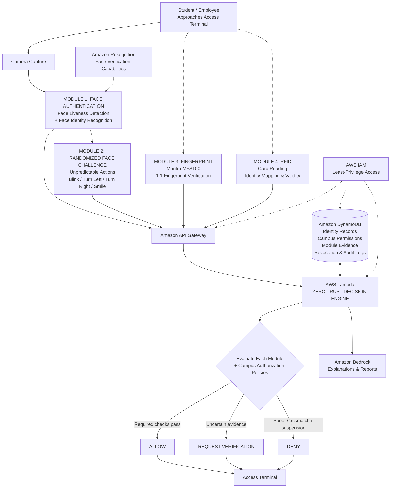

# verigate
Verify Identity. Establish Trust. Secure Access.

# VERIGATE
### Verify Identity. Establish Trust. Secure Access.

**Zero-Trust Multimodal Identity Verification & Campus Access Control System**

VERIGATE is a Zero-Trust campus access-control solution designed to strengthen identity verification and prevent unauthorized access through multimodal authentication and intelligent authorization.

The system combines facial authentication, randomized face challenges, fingerprint verification and RFID-based identification to establish reliable identity evidence. These independent verification modules feed into a centralized Zero Trust Decision Engine, which evaluates authentication results alongside campus authorization records, permissions, data freshness and revocation status before making an access decision.

Built around AWS services, VERIGATE aims to deliver secure, spoof-resistant and low-latency access decisions while maintaining transparent and auditable authorization.

---

## Problem Statement

Traditional access-control systems often rely on individual authentication mechanisms or synchronized records that may become outdated, inconsistent or vulnerable to impersonation.

A valid access card or successful biometric match alone does not necessarily establish that an individual should be granted access.

VERIGATE addresses this challenge by introducing a multimodal, Zero-Trust approach in which every authentication signal and authorization record is independently evaluated before access is granted.

The system is designed to detect biometric spoofing attempts, identify conflicting or stale campus records, enforce access restrictions and provide clear, auditable access decisions.

## Proposed Solution

VERIGATE introduces four independent verification modules integrated with a centralized Zero Trust Decision Engine.

### 1. Face Authentication
- Facial liveness detection to distinguish genuine users from spoofing attempts.
- Face identity recognition to verify the presented face against the enrolled identity.
- Detection and rejection of presentation attacks such as printed photographs, screen replays, video replays and face masks.
- Amazon Rekognition integration for supported facial verification capabilities.

### 2. Randomized Face Challenge
- Generates unpredictable facial action challenges.
- Uses actions such as blinking, turning left, turning right and smiling.
- Verifies whether the individual performs the requested action.
- Adds an additional layer of resistance against prerecorded and replayed attempts.

### 3. Fingerprint Authentication
- Integrates the Mantra MFS100 fingerprint scanner.
- Performs 1:1 fingerprint verification against an enrolled identity.
- Produces structured verification evidence for the central decision engine.

### 4. RFID Verification
- Reads the presented RFID card.
- Maps the card identifier to the associated student or employee.
- Validates card identity and status.
- Provides an identity claim that can be evaluated alongside other authentication evidence.

## Zero Trust Decision Engine

All four modules independently submit their verification results to a centralized AWS Lambda-based Zero Trust Decision Engine.

The engine evaluates:
- Individual authentication results.
- Identity consistency across verification modules.
- Campus enrolment and disciplinary records.
- Access permissions and restrictions.
- Record validity and freshness.
- Revocation status and authorization policies.

The system produces three possible outcomes:

| Decision | Description |
|---|---|
| **ALLOW** | Required identity and authorization checks are satisfied. |
| **REQUEST VERIFICATION** | Evidence is uncertain or additional verification is required. |
| **DENY** | Spoofing, identity mismatch, suspension or unauthorized access is detected. |

A successful result from one module cannot automatically override a security failure from another. Critical policy restrictions, such as suspension or detected spoofing, must be enforced by the decision engine.

## System Architecture



## AWS Technology Stack

| AWS Service | Purpose |
|---|---|
| **Amazon Rekognition** | Supported facial recognition and liveness capabilities. |
| **AWS Lambda** | Serverless execution and centralized Zero Trust decision logic. |
| **Amazon API Gateway** | Secure communication between authentication modules and backend services. |
| **Amazon DynamoDB** | Identity records, campus permissions, verification evidence, revocation data and audit logs. |
| **Amazon Bedrock** | Human-readable decision explanations, incident summaries and reports. |
| **AWS IAM** | Identity and access management with least-privilege permissions. |

## Technology Stack

**Backend**
- Python
- FastAPI
- Boto3

**Cloud Infrastructure**
- Amazon Web Services
- Amazon Rekognition
- AWS Lambda
- Amazon API Gateway
- Amazon DynamoDB
- Amazon Bedrock
- AWS IAM

**Hardware**
- Mantra MFS100 Fingerprint Scanner
- RFID Reader and card
- Arduino UNO
- female to female jumper wires
- buzzer
- SG90 servo motor
- leds (green and red)
- 220 ohm resistors x 2
- Camera / Webcam

**Frontend**
- Web-based authentication and access-control interface using React and Vite

## Key Objectives

- Improve identity verification through independent authentication mechanisms.
- Detect and prevent facial spoofing and replay attacks.
- Reduce false acceptance and false rejection rates.
- Minimize authentication and authorization latency.
- Evaluate campus authorization records rather than trusting individual credentials.
- Maintain traceable and auditable access decisions.
- Design a modular architecture that can be extended and deployed through AWS.

## Performance Evaluation

The prototype will be evaluated using measurable security and performance metrics:

| Metric | Evaluation |
|---|---|
| Face Recognition Accuracy | Correct identity verification rate. |
| False Acceptance Rate (FAR) | Incorrect acceptance of an unauthorized identity. |
| False Rejection Rate (FRR) | Incorrect rejection of a genuine identity. |
| Spoof Detection Rate | Successful detection of presentation attacks. |
| Decision Latency | Time taken to produce an access decision. |
| p95 Latency | 95th-percentile response time. |

Performance values will be reported based on actual prototype testing rather than assumed accuracy figures.

## Project Structure

```text
verigate/
│
├── backend/
│   ├── __init__.py
│   ├── app/
│   │   ├── __init__.py
│   │   └── main.py
│   ├── modules/
│   │   ├── __init__.py
│   │   ├── face_authentication/
│   │   ├── randomized_challenge/
│   │   ├── fingerprint/
│   │   └── rfid/
│   ├── tests/
│   │   └── face_authentication/
│   ├── .env.example
│   └── requirements.txt
│
├── aws/
│   ├── lambda/
│   ├── dynamodb/
│   └── iam/
│
├── architecture/
│   └── architecture.mmd
│
├── docs/
│   ├── API_CONTRACT.md
│   └── TESTING.md
│
├── .gitignore
└── README.md
```

## Team VERIGATE

| Team Member | Name |
|---|---|
| 1 | Mahathi S |
| 2 | Shreya Shenoy |
| 3 | P Samreen |
| 4 | Nandika Gupta |

## Project Vision

VERIGATE aims to move beyond conventional card-based and single-factor authentication by combining multimodal identity verification with Zero Trust authorization.

**We don't just verify who is requesting access. We verify whether that identity should be trusted for that specific access request.**

---

*Developed as part of the HID Hackathon 2026.*
